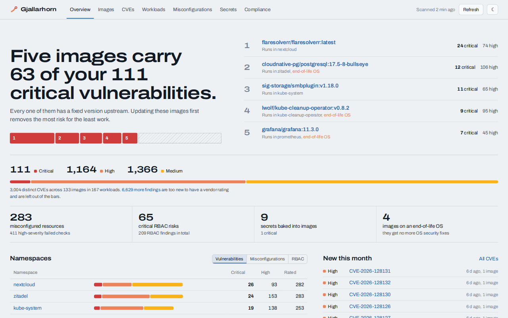

# Gjallarhorn

Gjallarhorn is a read-only dashboard over the reports the [Trivy Operator](https://github.com/aquasecurity/trivy-operator) writes to a Kubernetes cluster. It answers one question first: which few images hold most of your critical vulnerabilities, so you know what to update next.



It is one Rust binary that reads the `aquasecurity.github.io` reports, aggregates them in memory and serves a JSON API plus an embedded Svelte frontend.

## Features

- A "fix first" overview: the images that carry the largest share of critical (or high) findings, ranked.
- Images counted once per digest, however many pods run them. Reports on ReplicaSets are shown under their Deployment.
- Per image: findings grouped by package, with the version to update to that clears them all. End-of-life base OSes are flagged.
- CVEs across the cluster with how many images, workloads and namespaces each one reaches, plus the critical and high ones published in the last 30 days.
- Workload misconfigurations and RBAC risks, by resource or by check.
- Exposed secrets found in image layers. The matched text is never parsed or served.
- NSA and Pod Security Standards compliance from `ClusterComplianceReport`s.
- Findings without a vendor severity are counted as "not rated" and kept out of the bars, so they do not drown out rated ones.
- Light and dark themes, usable on a phone.

## Install

```bash
helm install gjallarhorn oci://ghcr.io/diverofdark/charts/gjallarhorn \
  --namespace gjallarhorn --create-namespace \
  --set ingress.enabled=true \
  --set 'ingress.hosts[0].host=security.example.com' \
  --set 'ingress.hosts[0].paths[0].path=/' \
  --set 'ingress.hosts[0].paths[0].pathType=Prefix'
```

The chart also lives in this repository under `charts/gjallarhorn`, which is what an Argo CD Application can point at.

Gjallarhorn needs the Trivy Operator installed and scanning. Its ClusterRole can only `get` and `list` the Trivy report types and `list` ReplicaSets.

There is no login. The page shows which images in your cluster are vulnerable, so keep the ingress on a private network or put an authenticating proxy in front of it.

## Documentation

The full documentation is at **<https://diverofdark.github.io/gjallarhorn/>**:

- [Overview](https://diverofdark.github.io/gjallarhorn/overview.html): how the "fix first" ranking works.
- [Images and CVEs](https://diverofdark.github.io/gjallarhorn/images.html), [workloads](https://diverofdark.github.io/gjallarhorn/workloads.html), [misconfigurations and RBAC](https://diverofdark.github.io/gjallarhorn/misconfigurations.html), [exposed secrets](https://diverofdark.github.io/gjallarhorn/secrets.html) and [compliance](https://diverofdark.github.io/gjallarhorn/compliance.html).
- [How findings are counted](https://diverofdark.github.io/gjallarhorn/counting.html).
- [Configuration](https://diverofdark.github.io/gjallarhorn/configuration.html), [endpoints](https://diverofdark.github.io/gjallarhorn/endpoints.html) and [permissions](https://diverofdark.github.io/gjallarhorn/permissions.html).

Its source is in [`docs/`](docs/SUMMARY.md), built with [mdBook](https://rust-lang.github.io/mdBook/): `mdbook serve` shows it locally.

## Development

```bash
(cd web && npm ci && npm run build)
cargo test
cargo run -- --bind 127.0.0.1:18080
```

With a kubeconfig, Gjallarhorn reads that cluster. `--fixtures fixtures/demo.json` serves made-up data without a cluster. For frontend work run `npm run dev` in `web/` with the backend on port 18080; Vite proxies `/api` to it.

The aggregation is in `src/snapshot.rs`. `build()` is pure, and its tests feed it report fixtures shaped like the operator's output.
