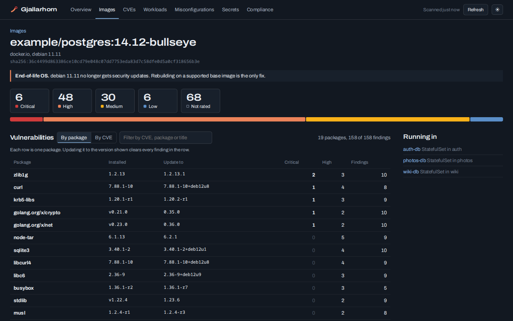

# Images and CVEs

## Images

One row per image digest, sorted by critical findings. Filters: free text (image, registry, OS or namespace), **Has critical**, and **End-of-life OS**.

## An image

The page shows the registry, OS and digest, a warning when the OS is end of life, and the counts by severity. Clicking a count filters the list below to that severity.

**By package** is the default. Each row is one installed package with the version to update it to, and how many critical, high and total findings that clears. The version shown is the highest fixed version across the package's findings, preferring stable releases over release candidates, so updating to it clears every finding in the row. Click a row for the CVEs behind it.

**By CVE** lists each finding with its package, installed and fixed version, CVSS score and title.

On the right: the workloads that run this image, and any secrets found in it.

## CVEs

Every distinct vulnerability in the cluster, sorted by severity and then by how many images it reaches. Filter by severity or by text: id, title, package or namespace. The first 300 rows render, with a button for more.

A CVE's page shows its severity, CVSS score, publication date, whether a fix exists, a link to the advisory, and every affected image with the package, installed and fixed versions, and the workloads running it.
