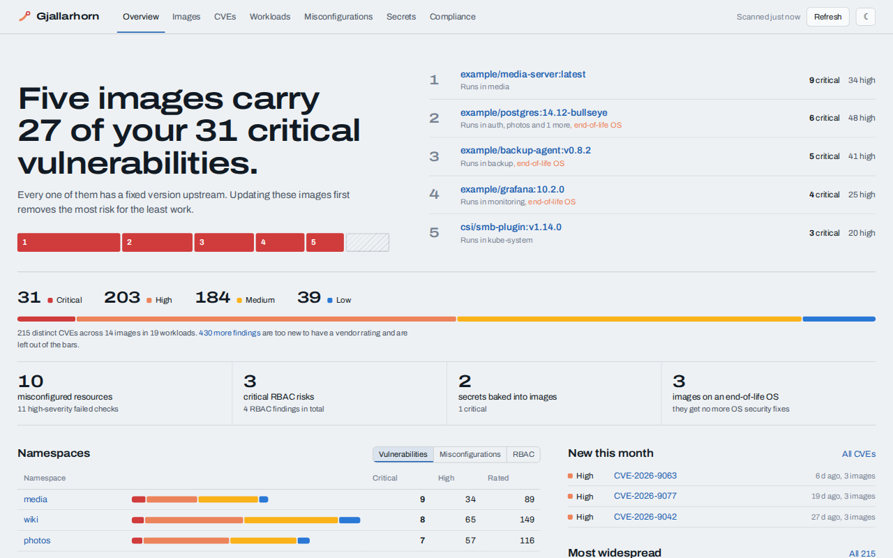

# Gjallarhorn

Gjallarhorn is a read-only dashboard over the reports the [Trivy Operator](https://github.com/aquasecurity/trivy-operator) writes to a Kubernetes cluster. It answers one question first: which few images hold most of your critical vulnerabilities, so you know what to update next.

It is one Rust binary. It reads the `aquasecurity.github.io` reports every two minutes, aggregates them in memory and serves a JSON API and an embedded Svelte frontend. On a cluster with about 130 images and 3,000 distinct CVEs one read takes about a second and peaks at about 170 MiB of memory.

## Features

- A "fix first" overview: the images that carry the largest share of critical findings, ranked, with the share each one holds.
- Images counted once per digest, however many pods run them. Reports on ReplicaSets show under their Deployment.
- Per image, findings grouped by package with the one version to update to. End-of-life base OSes are flagged.
- CVEs across the cluster with how many images, workloads and namespaces each one reaches, and the critical and high ones published in the last 30 days.
- Workload misconfigurations and RBAC risks, by resource or by check.
- Secrets found in image layers. The matched text is never read or served.
- NSA and Pod Security Standards compliance.
- Findings without a vendor severity are counted as "not rated" and kept out of the bars.
- Light and dark themes, usable on a phone.

Gjallarhorn does not scan anything itself and never writes to the cluster. What it shows is what the Trivy Operator found.
